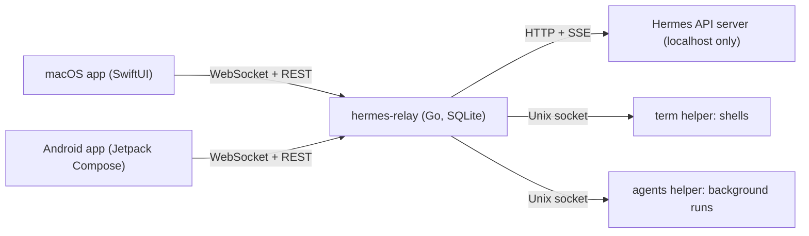

# hermes-relay

[](https://github.com/xMuramasa/hermes-relay/actions/workflows/ci.yml)


[](LICENSE)

The relay server and WebSocket protocol behind **Trismegistus**, native companion apps for
[Hermes Agent](https://hermes-agent.nousresearch.com) running on a home server: the macOS app
([trismegistus-mac](https://github.com/xMuramasa/trismegistus-mac), SwiftUI) and the Android app
([trismegistus-android](https://github.com/xMuramasa/trismegistus-android), Jetpack Compose). The apps talk only to
the relay. The relay holds the Hermes API key, keeps runs alive across flaky mobile connections, and gives every
device the same live view. This repo was `xMuramasa/trismegistus` until 2026-11-11; GitHub redirects the old links.



## What it does

- **Runs survive dropped connections.** One prompt is one Hermes run. The relay numbers and stores every event of
  the run; a device that comes back sends the last number it saw and gets the rest, so a locked phone or a lost
  signal never loses an answer.
- **One protocol, three codebases.** The WebSocket protocol is a JSON Schema ([`protocol/schema.json`](protocol))
  with valid and invalid example messages. The relay and both apps test against the same examples, and each app
  carries a copy with a staleness test.
- **Pairing and per-device access.** A QR code with a single-use code pairs a device; each device gets its own
  token. Revoking a device, or turning off one of its grants (the terminal is off by default), closes its live
  sockets within about 2 seconds.
- **Approvals from anywhere.** Commands that Hermes' reviewer escalates show up on every device as Once, This
  session or Deny.
- **More than chat.** REST endpoints for sessions, cron jobs, GitHub issues and the project board, background agent
  runs, message search and image attachments, plus a terminal drawer for the Mac app.
- **Safe to run.** The API key never leaves the server; logs never hold message text, tokens, pairing codes or
  approval commands (a test fails the suite if one does); every socket has size, rate and backlog limits.
- **Tested without a real Hermes.** `internal/fakehermes` replays recorded Hermes event streams with controllable
  timing: held streams, cut streams, silent streams and relay restarts.

Status: deployed on a homelab and used daily by both apps. The first Android client, an Expo app, was replaced by the
native app on 2026-11-02; its code is at the tag `expo-archive`. The design and its decisions are in
[SPEC.md](SPEC.md).

## Layout

- `SPEC.md`: what it does and why.
- `probe/`: phase 0 scripts and the recorded Hermes event streams used as test fixtures.
- `protocol/`: the WebSocket protocol, shared by the relay and the apps: `schema.json` (JSON Schema 2020-12),
  `examples/valid/` and `examples/invalid/`, and a short guide in `protocol/README.md`.
- `relay/`: the Go relay (one module, `github.com/xMuramasa/trismegistus/relay`).
  - `cmd/trismegistus-relay`: the binary and its subcommands.
  - `internal/config`: settings from the environment.
  - `internal/protocol`: message types and validation against an embedded copy of `protocol/schema.json`.
  - `internal/hermes`: Hermes REST + SSE client (timeouts, dead-stream detection, error mapping).
  - `internal/hub`: runs, Hermes event mapping, event numbering and storage, fan-out, re-attach after drops and
    restarts.
  - `internal/server`: HTTP routes (REST allowlist, pairing, health), WebSocket, auth, rate limits.
  - `internal/store`: SQLite (devices, pairing codes, runs, event log), schema migrations.
  - `internal/pairing`: tokens, pairing codes, the QR code.
  - `internal/fakehermes`: the fake Hermes the tests run against (replays `probe/fixtures/`).
  - `Dockerfile`: build context `relay/`.
- `agents/`: the host helper behind `/api/agents` (its own module and README).
- `term/`: the host helper behind `/api/terminal`, which owns the shells of the Mac app's terminal drawer (its own
  module and README).

## Protocol

Edit `protocol/schema.json`, add examples, then copy it into the relay:

```sh
cp protocol/schema.json relay/internal/protocol/schema.json
```

A relay test fails while the two differ.

## Relay

### Tests

```sh
cd relay
go vet ./... && go test -count=1 ./...
gofmt -l .        # must print nothing
# race detector (needs cgo, so in Docker), from the repo root:
docker run --rm -v "$PWD":/src -w /src/relay golang:1.27.3-bookworm go test -race -count=1 ./...
```

The tests need no network and no real Hermes: `internal/fakehermes` replays the phase 0 recordings with
controllable timing (holds, cut streams, silent streams, relay restarts). Every message the relay sends in the tests
is checked against the schema, and the suite fails if any log line contains a token, pairing code, prompt or steer
text, approval command or the Hermes key.

### Run locally

```sh
cd relay
HERMES_API_KEY=... DATA_DIR=./data PUBLIC_URL=http://localhost:8650 go run ./cmd/trismegistus-relay
```

### Docker

```sh
docker build -t trismegistus-relay --build-arg VERSION=$(git describe --always --dirty) relay
```

Distroless static image (~25 MB, runs as `nonroot`), binary at `/usr/local/bin/trismegistus-relay`, data in
`/data` (mount a named volume), `HEALTHCHECK` via the `healthcheck` subcommand. The compose file and Caddy config
live in the homelab repo.

### Environment

| Variable | Default | |
|---|---|---|
| `HERMES_API_KEY` | (required for `serve`) | Hermes API server key; never logged |
| `HERMES_URL` | `http://127.0.0.1:8642` | Hermes API server |
| `RELAY_ADDR` | `127.0.0.1:8650` | listen address (`172.18.0.1:8650` in the homelab) |
| `PUBLIC_URL` | (required for `pair`) | the relay's URL as the app sees it; goes in the pairing QR |
| `DATA_DIR` | `/data` | holds `relay.db` (SQLite, WAL) |
| `TRUSTED_PROXIES` | `127.0.0.1/32,172.16.0.0/12` | peers whose `X-Forwarded-For` is honored (rate limits) |
| `LOG_LEVEL` | `info` | `debug`, `info`, `warn`, `error` |
| `TERM_SOCKET` | (none) | the host helper `trismegistus-term`'s socket, an absolute path; empty and `/api/terminal` answers `not_configured` |
| `AGENTS_SOCKET` | (none) | the host helper `trismegistus-agents`' socket, for `/api/agents` (see `agents/README.md`) |
| `GITHUB_TOKEN`, `GITHUB_OWNER`, `GITHUB_PROJECT` | (none) | for the `/api/github` endpoints: a token, the owner and the project board's node id (`PVT_...`); never logged |

### Commands

```sh
trismegistus-relay [serve]                       # run the relay (default)
trismegistus-relay pair --name pixel-8 [--replace]  # QR + code for a new device (10 min, single use)
trismegistus-relay devices list
trismegistus-relay devices terminal macbook on   # or off: its terminals close within ~2 s
trismegistus-relay devices revoke pixel-8        # its sockets and terminals close within ~2 s
trismegistus-relay healthcheck                   # exit 0 if GET /healthz on RELAY_ADDR is ok
trismegistus-relay version
```

In the container: `docker exec -it trismegistus-relay trismegistus-relay pair --name pixel-8`. `pair` and
`devices` open the same database as the running server.
